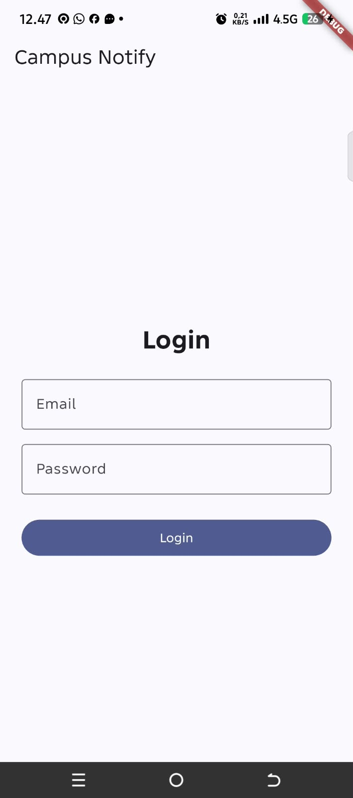
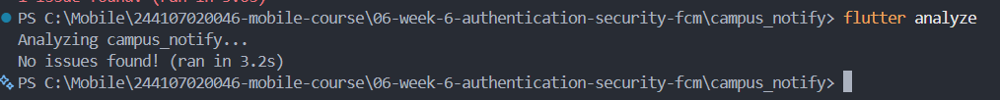
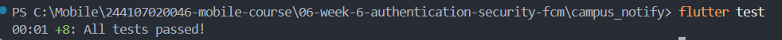
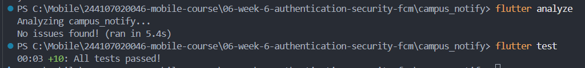

# campus_notify

### fcm console


| State | Yang diharapkan | Cara uji | Hasil aktual |
|---|---|---|---|
| Foreground | Notifikasi lokal muncul dan klik membuka `/pengumuman/3` | Aplikasi terbuka, kirim pesan, lalu klik notifikasi | Berhasil |
| Background | Notifikasi sistem muncul dan klik membuka `/pengumuman/3` | Tekan Home, kirim pesan, lalu klik notifikasi | Berhasil |
| Terminated | Aplikasi dibuka kembali dan menuju rute yang benar melalui `getInitialMessage()` | Tutup aplikasi dari recent apps, kirim pesan, lalu klik notifikasi | Berhasil |


### AI Prompt 
1. Android 13+ Notification Permission & Desugaring: Added <uses-permission android:name="android.permission.POST_NOTIFICATIONS"/> in AndroidManifest.xml and enabled isCoreLibraryDesugaringEnabled = true in build.gradle.kts.
2. GoRouter Guard Deep-Link Bypass: Updated redirect logic in lib/main.dart to allow public announcement routes (/announcement/:id) without being blocked by /login.
3. Local Notification Tap Syntax & Callback: Fixed InitializationSettings parameter name syntax (settings:) and bound _onRouteTap callback to navigate immediately on tap.





### Reflection
1. Mengapa refresh token tidak boleh disimpan di SharedPreferences? Apa risikonya bila bocor?
- Refresh token tidak disarankan disimpan di SharedPreferences karena penyimpanan tersebut tidak dirancang khusus untuk melindungi data sensitif. Jika perangkat berhasil diakses oleh pihak yang tidak berwenang atau aplikasi memiliki celah keamanan, token berisiko terbaca.
Jika refresh token bocor, orang lain dapat menggunakannya untuk meminta access token baru dan mengakses akun pengguna tanpa harus mengetahui password, selama token masih berlaku dan belum dicabut. Oleh karena itu, refresh token sebaiknya disimpan menggunakan penyimpanan yang lebih aman, seperti flutter_secure_storage.

2. Apa yang rusak bila onTokenRefresh diabaikan selama satu semester perkuliahan?
- aplikasi mungkin masih menggunakan FCM token lama ketika Firebase mengganti token perangkat. Akibatnya, server dapat menyimpan token yang sudah tidak berlaku sehingga notifikasi berisiko gagal dikirim ke perangkat pengguna.
Selama satu semester, kondisi ini dapat menyebabkan mahasiswa tidak menerima informasi penting, seperti perubahan jadwal kuliah, pengumuman ujian, atau informasi tugas. Karena itu, aplikasi perlu mendengarkan perubahan token melalui onTokenRefresh dan mengirimkan token terbaru ke server agar data perangkat tetap diperbarui.

3. Kapan memakai topik dan kapan memakai token perangkat? Beri contoh pesan kampus untuk masing-masing.
- Topik (topic) digunakan ketika pesan ditujukan kepada banyak pengguna yang memiliki kesamaan tertentu. Dengan topik, aplikasi dapat mengirimkan satu pesan kepada banyak perangkat yang telah berlangganan topik tersebut.
Contoh: mahasiswa berlangganan topik pengumuman-kampus. Ketika kampus mengirimkan informasi libur perkuliahan, semua perangkat yang berlangganan topik tersebut dapat menerima notifikasi.
- Token perangkat (device token) digunakan ketika pesan ditujukan kepada perangkat tertentu. Setiap perangkat memiliki FCM token yang digunakan untuk menentukan tujuan pengiriman notifikasi.
Contoh: aplikasi mengirimkan notifikasi pengingat kepada seorang mahasiswa bahwa pembayaran UKT miliknya belum diselesaikan.

4. Bagian mana dari draf AI yang Anda tolak atau perbaiki, dan mengapa?
- Android 13+ Permission & Desugaring: Initial AI boilerplate omitted POST_NOTIFICATIONS in AndroidManifest.xml and isCoreLibraryDesugaringEnabled in Gradle. Without these, builds fail or notifications are blocked silently on Android 13+.
- GoRouter Guard Blocking Deep Links: Initial AI draft route guards redirected unauthenticated deep link navigation to /login. Fixed the guard redirect logic to allow public announcement routes (/announcement/:id).
- Foreground Banner Callbacks: Fixed InitializationSettings parameter syntax for flutter_local_notifications and bound tap callbacks (_onRouteTap) so local notification clicks trigger router.go(route).

# Week 7 - Audit Arsitektur 

## 1. Struktur Fitur Notes Setelah Refactoring

``` text
lib/
├── core/
│   ├── failures.dart
│   └── providers.dart
├── data/
│   ├── api_client.dart
│   ├── auth_repository.dart
│   └── token_store.dart
├── features/
│   └── notes/
│       ├── data/
│       │   ├── notes_database.dart
│       │   ├── models/
│       │   │   └── note_model.dart
│       │   └── repositories/
│       │       └── note_repository_impl.dart
│       ├── domain/
│       │   ├── entities/
│       │   │   └── note.dart
│       │   ├── repositories/
│       │   │   └── note_repository.dart
│       │   └── usecases/
│       │       ├── add_note.dart
│       │       └── get_notes.dart
│       └── presentation/
│           ├── pages/
│           │   └── notes_page.dart
│           └── providers/
│               └── notes_providers.dart
├── messaging/
│   ├── push_service.dart
│   └── route_parser.dart
├── pages/
│   ├── announcement_page.dart
│   ├── home_page.dart
│   └── login_page.dart
└── providers/
    └── auth_provider.dart
```

###  Setiap Layer

-   **Domain** berisi aturan inti fitur Notes, yaitu entity `Note`,
    kontrak `NoteRepository`, dan use case seperti `GetNotes` serta
    `AddNote`.
-   **Data** menyediakan implementasi penyimpanan catatan melalui
    `NoteRepositoryImpl`, model `NoteModel`, dan pengelolaan database
    lokal.
-   **Presentation** berisi halaman Notes dan provider Riverpod yang
    menghubungkan UI dengan use case.
-   **Core** menyediakan tipe kegagalan seperti `Failure`,
    `LocalFailure`, dan `NetworkFailure` yang digunakan oleh bagian
    terkait.

## 2. Implementasi Refactoring

### 2.1 Entity `Note`

File: `lib/features/notes/domain/entities/note.dart`

Entity `Note` merepresentasikan data inti catatan. Properti yang
dimiliki meliputi `id`, `title`, `body`, `updatedAt`, dan `dirty`.
Entity ini ditempatkan di domain agar representasi inti catatan tidak
terikat pada model database tertentu.

### 2.2 Repository Interface

File: `lib/features/notes/domain/repositories/note_repository.dart`

`NoteRepository` merupakan kontrak abstrak yang mendefinisikan operasi
`fetchNotes()` dan `addNote()`. Kontrak ini menggunakan entity `Note`
serta tipe `Failure`, tanpa mengharuskan domain mengetahui cara data
disimpan.

### 2.3 Use Case `GetNotes`

File: `lib/features/notes/domain/usecases/get_notes.dart`

`GetNotes` menerima `NoteRepository` melalui constructor. Ketika
dipanggil, use case meneruskan permintaan ke `fetchNotes()` dan
mengembalikan hasil yang berisi daftar catatan serta kemungkinan
`Failure`.

Dengan cara ini, use case bergantung pada abstraksi repository, bukan
langsung pada database atau implementasi repository tertentu.

### 2.4 Repository Implementation

File: `lib/features/notes/data/repositories/note_repository_impl.dart`

`NoteRepositoryImpl` mengimplementasikan `NoteRepository`. Implementasi
ini membuka database, mengambil catatan berdasarkan `updated_at` secara
menurun, mengubah hasil query menjadi entity melalui `NoteModel`, dan
menangani kegagalan operasi dengan mengembalikan `LocalFailure`.

Operasi `addNote()` juga menyimpan catatan baru dan mengembalikan entity
hasil penyimpanan atau `Failure` apabila operasi gagal.

### 2.5 Provider Riverpod

File: `lib/features/notes/presentation/providers/notes_providers.dart`

Provider menghubungkan implementasi repository, use case `GetNotes`, dan
state yang digunakan oleh UI. `notesProvider` memanggil use case dan
meneruskan daftar catatan ke presentation. Jika hasil mengandung
`Failure`, provider melempar exception agar state error dapat ditangani
oleh UI.

## 3. AI Challenge 

### Evaluasi Usulan

  -----------------------------------------------------------------------
  Area                    Keputusan implementasi  Alasan
  ----------------------- ----------------------- -----------------------
  Pemisahan layer         Diterapkan pada fitur   Membuat tanggung jawab
                          Notes                   inti, penyimpanan, dan
                                                  UI lebih jelas

  Entity di domain        Diterapkan melalui      Domain tidak perlu
                          `Note`                  menggunakan model
                                                  database secara
                                                  langsung

  Repository interface    Ditempatkan di domain   Use case bergantung
                                                  pada kontrak, bukan
                                                  implementasi data

  Repository              Ditempatkan di data     Detail query dan
  implementation                                  pemetaan model menjadi
                                                  tanggung jawab data
                                                  layer

  Use case                Menggunakan `GetNotes`  Operasi fitur dapat
                          dan `AddNote`           dipanggil melalui kelas
                                                  use case

  Dependency injection    Menggunakan Riverpod    Menghubungkan objek
                                                  tanpa menambahkan
                                                  package DI khusus

  Kompleksitas arsitektur Refactoring difokuskan  Menghindari klaim bahwa
                          pada Notes              seluruh aplikasi sudah
                                                  direstrukturisasi
  -----------------------------------------------------------------------

Tabel ini mendokumentasikan keputusan yang tampak dari struktur dan kode
yang diperiksa. Jika terdapat usulan AI yang ditolak atau
disederhanakan, tambahkan usulan asli dan alasan teknisnya berdasarkan
percakapan AI yang sebenarnya.

## 4. Pengujian

### 4.1 Analisis Kode

Perintah yang dijalankan:

``` powershell
flutter analyze
flutter test
```

Hasil ini menunjukkan bahwa Flutter analyzer tidak menemukan masalah
analisis kode pada project saat pemeriksaan dilakukan.

### 4.2 Unit Test `GetNotes`

Perintah yang dijalankan:
``` powershell
flutter test test/get_notes_test.dart
```

Hasil terminal:
``` text
00:03 +2: All tests passed!
```

Dua skenario yang terdapat pada pengujian tersebut adalah:

1.  **Skenario berhasil:** `GetNotes` meneruskan daftar catatan dari
    fake repository dan tidak mengembalikan failure.
2.  **Skenario gagal:** `GetNotes` meneruskan `LocalFailure` dari fake
    repository dan daftar catatan kosong tanpa melempar failure secara
    langsung.

Kedua skenario tersebut berhasil berdasarkan output terminal yang
dikirimkan.

**Batasan hasil:** pengujian di atas hanya menjalankan file
`test/get_notes_test.dart`. Hasil seluruh test dalam project belum
dicatat dalam laporan ini. Untuk memeriksa semuanya, jalankan
`flutter test`.

## 5. Verifikasi Dependency Rule

Pemeriksaan dilakukan menggunakan tiga perintah PowerShell.

### 5.1 Pemeriksaan Import Framework dan Library Data

``` powershell
Get-ChildItem lib/features/notes/domain -Recurse -Filter *.dart |
  Select-String -Pattern "package:flutter|package:sqflite|package:dio"
```

**Hasil:** tidak ada output yang cocok.

Interpretasi: tidak ditemukan baris yang cocok dengan pola import
Flutter, sqflite, atau Dio pada file Dart di folder domain Notes.

### 5.2 Pemeriksaan Import ke Data Layer

``` powershell
Get-ChildItem lib/features/notes/domain -Recurse -Filter *.dart |
  Select-String -Pattern "features/notes/data|../data|../../data"
```

**Hasil:** tidak ada output yang cocok.

Interpretasi: tidak ditemukan baris yang cocok dengan pola import menuju
data layer pada file Dart di folder domain Notes.

### 5.3 Pemeriksaan Interface dan Implementasi Repository

``` powershell
Get-ChildItem lib/features/notes -Recurse -Filter *.dart |
  Select-String -Pattern "abstract class NoteRepository|class NoteRepositoryImpl"
```

**Hasil terminal:**

``` text
lib\features\notes\data\repositories\note_repository_impl.dart:7:class NoteRepositoryImpl implements NoteRepository {
lib\features\notes\domain\repositories\note_repository.dart:4:abstract class NoteRepository {
```

Interpretasi: interface `NoteRepository` berada di domain, sedangkan
`NoteRepositoryImpl` berada di data layer. Pemisahan tersebut sesuai
dengan tujuan agar domain mendefinisikan kontrak dan data layer
menyediakan implementasinya.

### 5.4 Kesimpulan Verifikasi

Hasil pemeriksaan mendukung bahwa fitur Notes sudah memisahkan
repository interface dan implementasinya serta tidak menunjukkan import
langsung yang cocok dengan pola pencarian pada domain. Pemeriksaan
berbasis pencarian teks ini memiliki keterbatasan: hasil kosong bukan
bukti mutlak bahwa semua bentuk ketergantungan sudah benar. Karena itu,
hasil tersebut perlu dibaca bersama struktur kode dan hasil pengujian.


## Refleksi

1. Mengapa Repository Interface Diletakkan di Domain?
- Repository interface diletakkan di domain karena domain mendefinisikan
kebutuhan data yang diperlukan oleh aturan bisnis. Implementasi
penyimpanan dapat berubah tanpa mengharuskan use case bergantung pada
detail database. Jika interface justru bergantung pada implementasi
data, arah ketergantungan menjadi lebih sulit dikendalikan dan pengujian
domain dapat lebih terikat pada detail penyimpanan.

2. Kapan Use Case Diperlukan?
- Use case berguna untuk merepresentasikan satu tindakan atau aturan
aplikasi, misalnya mengambil atau menambahkan catatan. Use case membantu
ketika operasi memiliki aturan bisnis, validasi, atau perlu digunakan
kembali. Untuk operasi yang sangat sederhana, meneruskan repository
langsung dari notifier dapat mengurangi jumlah kelas. Pilihan perlu
disesuaikan dengan kompleksitas dan kebutuhan pengembangan, bukan
sekadar menambah lapisan.

3. Apa Risiko Over-Engineering?
- Terlalu banyak abstraksi, kelas, dan lapisan pada fitur yang sederhana
dapat membuat alur program lebih panjang dan sulit diikuti. Karena itu,
refactoring ini difokuskan pada pemisahan tanggung jawab yang jelas pada
fitur Notes, tanpa menyatakan bahwa setiap bagian aplikasi harus
memiliki lapisan tambahan yang tidak dibutuhkan.

4. Evaluasi Bantuan AI
- AI dapat membantu memberikan alternatif struktur folder, contoh
pemisahan layer, dan rancangan pengujian. Namun, hasil AI tetap perlu
dibandingkan dengan kode aktual, kebutuhan project, dan hasil
pemeriksaan. Implementasi tidak boleh dianggap benar hanya karena
disarankan AI; kode perlu dianalisis dan diuji. Bagian ini dapat
dilengkapi dengan contoh spesifik saran AI yang diterima, dimodifikasi,
atau ditolak setelah mencocokkannya dengan percakapan AI yang
sebenarnya.

## 8. Kesimpulan
Refactoring fitur Notes pada project `campus_notify` telah menghasilkan
pemisahan domain, data, dan presentation. Domain memiliki entity,
repository interface, dan use case; data layer memiliki model serta
repository implementation; sedangkan presentation menggunakan Riverpod
untuk menghubungkan use case dengan UI.

Berdasarkan output yang diperiksa, `flutter analyze` tidak menemukan
masalah analisis kode dan dua unit test pada `test/get_notes_test.dart`
berhasil. Tiga pemeriksaan Dependency Rule juga menunjukkan hasil yang
sesuai dengan tujuan pemisahan layer pada fitur Notes. Meskipun
demikian, pemeriksaan seluruh test, verifikasi perilaku aplikasi secara
langsung, dan penyertaan screenshot masih perlu dilakukan atau
didokumentasikan sebelum laporan dinyatakan lengkap.
